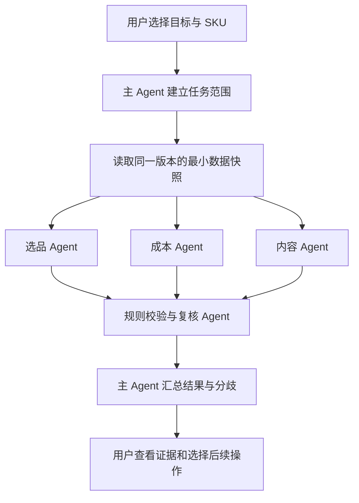

# 电商多 Agent 协作方案

设计 v0.4 · 2026-11-01 · **M1 已实现；M2/M3 待实施**

当前实现：固定规则/模板、单一只读快照、三专业角色并行、复核汇总、限额/超时/取消、来源基线及会话报告。字段与状态以 DATA_CONTRACT 第 9 节为准。下文保留设计缘由和后续路线；不表示接入了真实模型。浏览器和自动化验收证据见 CHANGELOG。

用户明确选择：在电商应用内部，由选品、内容、成本等 Agent 分工，主 Agent 汇总。本文是 [PRD](PRD.md) 的协作设计补充；M1 采用离线规则角色，不授权实现平台执行功能。

## 1 借鉴的体验与本项目的实现选择

截至本次查阅，Grok Bot 官方介绍包括固定角色、并行工作、共享任务上下文及交接；本项目借鉴这些交互特点。官方产品还提供云端电脑和跨应用操作，这些不在本项目现有边界内。[Grok Bot 官方说明](https://docs.x.ai/grok-bot/overview)

xAI 的多 Agent 研究 API 是另一项能力：多个研究角色协作，由领队汇总。它不能被当成“自动拥有可独立控制的电商 Agent 团队”的依据。本方案自行控制角色、数据和工具，不要求绑定 Grok 模型或复制其内部实现。[Multi Agent 官方文档](https://docs.x.ai/developers/model-capabilities/text/multi-agent)

下面的角色数、流程、限额和页面均为本项目的设计建议，不是对 Grok 内部架构的陈述。

## 2 五个角色，一个任务房间

| 角色 | 职责 | 允许的数据/工具 | 可交付结果 |
| --- | --- | --- | --- |
| 主 Agent | 理解目标，选择流程，分派工作，汇总分歧 | 本轮任务范围、各角色结构化结果、只读校验结果 | 总结、证据缺口、建议下一步 |
| 选品 Agent | 比较已录入候选、报价与研究，解释适用性 | 当前选中商品及关联报价、研究、核验和必要历史审计；既有评分服务 | 比较表、场景限制、支持/反驳证据、待补项 |
| 成本 Agent | 解释经济性及影响因素 | 同一任务快照中的 SKU 与报价；既有 Decimal 经济性函数 | 已知成本、未知项、估计贡献、保本 CAC |
| 内容 Agent | 检查事实、素材和内容准备情况 | 当前 SKU 的事实与素材索引；离线模板只读预览 | 可用事实、拍摄清单、待核实项、未保存草稿预览 |
| 复核 Agent | 检查跨角色一致性、证据引用及遗漏 | 任务快照、各角色结果、确定性规则检查 | 冲突、阻断、缺失和复核摘要 |

五个角色不等于五个模型或五份订阅。未来可以共用一个模型，但各有任务上下文、允许的工具和输出要求；模型品牌不写死在业务规则中。角色配置在首版固定，不增加可任意执行代码的“自建 Agent”。

主 Agent 不重新计算利润；选品 Agent 不自行生成评分；内容 Agent 不写未经核实的商品陈述；复核 Agent 的判断不能把样品 fail、权限未知或缺成本改成已通过。真人核验和既有硬规则仍有最终约束力。

M1 的角色由规则及离线模板模拟，界面明确写“离线协作演示”。M2 接入真实模型后才称为模型协作；不能把同一条固定回答换五个名字展示为五个 AI 的研究。

## 3 首个端到端任务

**“评估我选中的已录入 SKU，给出报价/经济性比较、证据缺口和内容准备建议。”**

首版通过明确选择任务模板、数据空间和最多 3 个 SKU 发起任务。可输入目标说明，但 M1 不声称能理解任意自然语言或任意自主规划。首次只做单件 SKU 评估，不把订单复盘、对账、自动找货和全店运营同时纳入。



主 Agent 在派发时确定范围，三个专业角色可以并行；复核依赖它们的结果，最终汇总依赖复核。简单的“算一下这个 SKU”只需要成本能力，无须启动全部角色；自由路由属于 M2，M1 使用固定流程。

以合成 S-01 为例，成本角色引用服务输出 8.40 元预计贡献，选品角色说明所选报价的证据与适用性，内容角色列出现有事实和缺少素材，复核角色检查引用及限制是否被遗漏。没有研究或已核实事实时，直接输出待补项，不生成市场结论或虚构文案。

角色之间传递简短结论、依据与请求，不循环广播全部聊天历史。M1 不允许 Agent 自动再创建 Agent 或无限互相讨论；发现分歧保留在结果中，不能用多数投票抹掉失败核验。

## 4 从任务到结果的页面

目标体验是“协作工作台”：左侧角色与任务入口，中间任务进度及交接，右侧证据、当前结果和待用户判断事项。窄窗口改为顺序展示。

```text
协作工作台                       真实数据 / 离线协作演示
任务：SKU 评估                   对象：S-01、S-03

主 Agent       已分派            [查看任务范围]
选品 Agent     已完成            [证据与缺口]
成本 Agent     已完成            [金额及来源]
内容 Agent     待补资料          [可用事实与素材]
复核 Agent     已完成            [限制与分歧]

汇总：S-01 为假设估算；S-03 缺获客费，贡献不可完整计算
下一步：核对指定缺失项，进入原有编辑或内容页面
[查看来源] [导出本次报告] [重新运行]
```

只展示实际发生的调度、工具调用摘要、产物和简短理由，不编造“讨论中”聊天气泡，不展示或要求模型隐藏推理。任务进度来自实际事件，不用定时动画假装多个角色工作。

任务运行状态与经营判断分开：运行成功也可能得到“证据不足”或“被规则阻断”。“任务完成”不能显示为“商品可销售”“内容可发布”或“已执行”。

M1 在现有应用增加一个协作入口，保留原页面。六工作区的全面重组仍属后续 R1；无需先改完所有导航才验证协作价值。

## 5 一致的数据、受限的工具

调度器在一次只读事务中读取该任务需要的当前记录及 revision，转换为不可变的任务快照后结束事务；长期推理不持有数据库读锁。各角色只拿所需字段的副本，不直接获得数据库连接、任意 SQL、终端、浏览器或文件系统权限。

新增关联、记录删除及修订都必须能使原基线失效；只比对已选记录的 revision 不足以发现新增证据。实现时需为任务相关集合建立规范化基线，定义清单与算法的唯一位置是 DATA_CONTRACT。M1 开始先补此契约，再写测试。

M1 的只读工具仅覆盖 SKU 数据、评分、经济性、事实/素材和模板预览。工具清单由代码按角色检查，不能只在提示词里要求“不要越权”。证据文本中的指令只是数据，不能改变角色权限。

现有 `drafts.create_draft` 会写数据库，不可直接包装成“只读内容工具”。需要从现有规则抽出纯预览能力；保存草稿仍由用户进入现有页面完成。评分抽取要携带历史失败审计；不能因为只读快照漏掉审计而自动解除旧 fail。

若以后加入订单复盘，P4 报告必须改造为支持同一输入快照，或明确作为另一独立任务；不能在同一次 SKU 快照里混入另一时点报告而声称一致。订单流程另补验收，不在 M1 顺带实现。

汇总展示前、导出前及跳转时核对当前相关基线。已变化则标“来源已更新”，可以查看本次旧结果，但停止正常结果导出并要求重新运行；不自动重跑或把旧结论作为当前建议。跳转后原页面重新读取与预检，依然可能再次发现并发变化。

## 6 结果、记忆与最小契约扩展

**DATA_CONTRACT 第 9 节现已定义 M1 运行结构。** 包括任务范围与基线、角色产物和运行事件三组内存数据结构；它们不是新的订单、费用或审批实体。字段、类型、状态转换和序列化规则仅在 DATA_CONTRACT 维护。

每个角色结果必须能回答：针对哪个目标、完成了什么、使用哪些来源与修订、哪些结论是事实/假设/建议、哪些仍未知、是否违反规则、运行是否完整。金额来自服务结果，不接受角色自行写入另一个利润字段。引用必须属于本轮获准快照并可查到原记录。

事实、推断与建议分区展示。模型写出的“已核实”不能修改 DraftFact 或 CandidateCheck；内容产物继续遵守现有事实原文约束。角色报告不是 ContentDraft、ActionProposal 或新证据，不能自动导入这些实体。

M1 只保留本地会话内的运行与事件，可由用户下载报告；刷新、会话断开或应用重启不保证恢复，不承诺 24 小时常驻或历史重放。报告记录目标、数据时点、输入修订、流程版本、角色结果及离线模式，无原始提示词或消费者信息。

固定角色职责可以随代码保留。跨任务长期记忆留到 M3：仅保存经用户确认的偏好与工作摘要，仍须重新读取当前报价、费用和核验；旧讨论不能变成事实证据。M3 的存储、清理、备份和恢复都要先扩展契约并验收。

## 7 运行限制和失败语义

M1 初始产品限额建议：一次最多 3 个 SKU、3 个并行专业角色，每个角色最多运行一次；复核与汇总各一次，不自动重试。单步超时建议 30 秒，全任务 120 秒，均为可测试配置，不是性能承诺。

- 一个角色失败时保留其他结果，显式显示缺失角色与原因；不得输出“完整评估”。复核失败时只展示未经复核的部分产物。
- 用户取消后停止派发后续步骤；正在执行的只读工作尽可能取消，不能取消的迟到结果丢弃，不复活任务或改变业务数据。
- 同一会话重复点击运行不启动重复任务；页面重绘不重发工具调用。主动重新运行创建新运行标识并重读数据，不混入前次结果。
- 数据空间切换使当前运行脱离可用上下文，取消后续派发并隔离迟到结果；跨空间同名 ID 不能互用。
- 后台执行部分不调用 Streamlit 控件；界面只消费状态与事件。实现需清理已结束任务及执行器资源，不为五个角色启动五个常驻服务。
- 缺少资料是业务结果，不自动重试；工具越权或输出无法验证时拒绝该产物。遇到不可预期错误只记录脱敏摘要。

M2 在调用真实模型前额外设请求数、输出长度、总 token 预算及超时；每步重试最多一次且计入同一总预算，预算不足不再派发。未返回用量时显示“未知”，不能填 0；没有供应商价格依据不宣称实际成本。取消不保证收回已发出请求的费用。

## 8 分层和实施批次

UI 负责任务、进度和证据展示；本地编排器负责依赖、限额、取消与结果汇总；角色负责分析职责；工具适配层调用既有查询和确定性服务。字段、数学、评分、写入校验继续由现有业务层控制。

M1 可新增 `agents/` 下的流程、角色、只读工具及输出校验模块，另加一个协作页；确切模块数以职责为准。不重写全部业务层，不预先引入消息队列、向量库、分布式服务或 Agent 框架。未来仅在恢复、多进程或模型适配需求证实后选择依赖。

| 批次 | 可验收交付 | 本批不包含 |
| --- | --- | --- |
| **M1 已实现：离线协作闭环** | 一个 SKU 评估流程、5 个固定角色、真实独立调度、只读快照、事件与证据、失败/取消、报告；运行契约与 A27–A32 已落实 | 真实模型调用、长期记忆、订单任务、自动业务写入、整站导航重做 |
| M2：真实模型协作 | 在同一接口后接一个模型 Provider，默认关闭；逐角色上下文、受限工具、输出校验、预算；离线模式继续可用 | 平台抓取/连接、自动发布交易、无限 Agent 群聊 |
| M3：复用与持续性 | 按真实需求增加订单复盘流程、持久任务/用户确认的偏好、恢复与清理；先定契约和验收 | 未授权的常驻自动经营 |
| R1–R3：体验整理 | 沿 PRD 重组导航、商品详情、内容与导入；结合协作入口整合 | 用 UI 改动绕过业务规则 |

M1 与 R1–R3 已完成，并按用户选择交付完整离线版。M2 为可选后续：外部模型请求须由用户明确要求启用，选择供应商、数据范围和预算；启用推理接口不等于授权 P6 平台连接。

## 9 验收与是否值得多 Agent

M1 验证对象正确、金额一致、证据可追溯、分工真实、失败可见和无副作用；不验证“多 Agent 更聪明”。M2 使用同一批固定合成任务，比较单 Agent 和多 Agent 的遗漏、无依据陈述、工具结果错误、完成率、耗时和实际用量。多 Agent 没有带来收益的简单任务保留单角色入口。

没有用运行成功率代替经营有效性，没有以五个角色达成共识证明资料真实。第一份成果应是用户能够核对的评估报告与待补清单，而不是“自动开店”演示。
