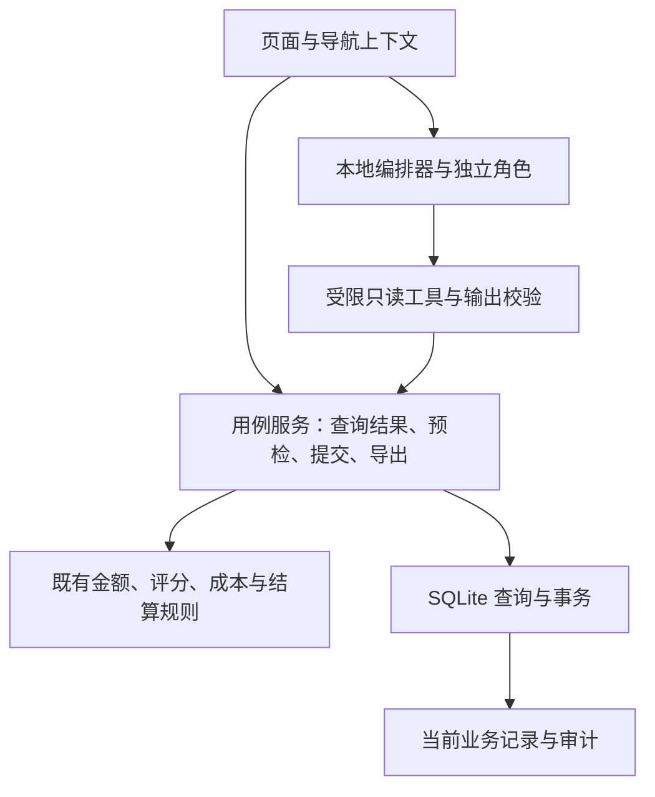

# XHS Seller Copilot · 多 Agent 协作与体验方案

方案版本 v0.7 · 2026-11-01 · **M1/R1/R2/R3 已实现；M2/M3 待实施**

实施状态：六组导航、对象定位、只读经营提醒、离线协作、R2 商品详情/内容事实选择及 R3 统一导入/订单来源核对已交付，详见 README 与 CHANGELOG。下文保留原体验路线与设计依据；“本轮仅方案”等表述指方案编写轮次。M1 内存运行结构已在 DATA_CONTRACT 第 9 节落定，R1–R3 未改字段或公式，没有新增业务表。

用户在体验与架构改版基础上明确增加方向：借鉴角色协作方式，在电商应用内部让选品、内容、成本等 Agent 分工，由主 Agent 汇总。具体设计见 [多 Agent 方案](MULTI_AGENT_DESIGN.md)。M1 离线协作闭环与 R1–R3 体验改版已交付，真实模型仍属后续路线。

以现有 P0–P5 为业务底座。字段、金额、修订和导入规则仍以 [DATA_CONTRACT](DATA_CONTRACT.md) 为唯一真源，评分仍遵循 [SCORING_RULES](SCORING_RULES.md)。M1 已先补最小内存运行契约再编码；无数据库迁移。

## 1 现状与要解决的问题

以下来自当前代码和文档静态检查，尚未进行本轮浏览器走查或用户计时；体验收益是待验证的设计判断。

| 当前证据 | 对使用的影响 | 设计响应 |
| --- | --- | --- |
| `app.py` 有 9 个平级入口；首页只列候选、报价、SKU 数量和说明 | 首页不能直接指出需要处理的事项 | 改为工作台，提供现有异常与待审提案入口 |
| 候选、报价、经济性在 `app.py`；研究、内容分别在 `ui_p2.py`、`ui_p3.py` 选择 SKU | 同一商品的查看过程分散，各页独立选择上下文 | 选品工作区集中查看，跨工作区携带目标 |
| `ui_p1.py` 通过实体类型和字段表单编辑，已预填 revision 与时间 | 用户仍需理解实体、外键和技术字段才能完成业务操作 | 增加带上下文的业务入口；技术字段放入版本详情 |
| P1/P2 导入位于“编辑与导入”，P4 导入位于订单页 | 导入入口分散，但两者校验和确认条件并不相同 | 统一入口与展示组件，保留各自的业务验证 |
| 金额、评分、导入、草稿、报告、提案已有服务；`app.py` 和 `ui_p2.py` 仍直接组合查询 | 新页面容易重复取数、过滤与对象关联逻辑 | 将被新页面复用的查询逐项抽出，复用现有领域函数 |
| README 使用旧机器路径；原开发指令只要求 P0；TASKS 已记录 P0–P5 | 新开发容易误判项目阶段 | 明确当前能力、改版计划和下一次单阶段入口 |

现有预检、原子提交、未知金额、草稿来源校验和提案审计是改版的基础。数据库和服务无需整体重写。现有备份支持生成与检查快照，恢复流程尚未验收，不能承诺“一键回滚数据”。

## 2 产品定位与成功标准

面向单人店主的本地经营协作工作台：用户交给主 Agent 一个明确任务，专业角色分工分析本地资料，复核后汇总证据、缺口与建议。现有页面仍可直接查看、编辑和核对；经营操作始终由用户在外部人工完成。

首个协作任务限定为已录入 SKU 评估。主 Agent 管分派与汇总，选品、成本、内容三个角色并行，复核角色检查一致性和阻断。M1 使用离线规则与模板模拟，M2 才接真实模型；独立角色不要求独立模型。详见 [角色、工具及交接](MULTI_AGENT_DESIGN.md)。

本次改版优先减少三种成本：找入口、重复选择对象、理解技术字段。先完成下列可观察目标，再考虑扩大功能：

- 从工作台的一条提醒，可直接进入对应记录或在目标页明确高亮该记录。
- 同一数据空间内从选品进入研究或内容，不再手工重复选择同一 SKU；到达页仍展示名称及 ID 供核对。
- 所有保存动作都有清楚的对象、变更内容和结果；导入仍经过完整预检及人工确认。
- 页面不自行计算金额、评分或决定权限；同一业务结论来自同一现有服务。

不以成交、利润增长、销量预测或外部操作数量作为软件验收指标。

## 3 信息架构：6 个主入口，按任务进入

| 主入口 | 子页与内容 | 对应现有能力 |
| --- | --- | --- |
| 协作工作台 | 任务与角色进度、结果和证据；待审提案、成本待补与结算提醒 | M1 协作入口、首页、P4 报告、P5 提案/异常 |
| 选品工作区 | 候选与报价、SKU 经济性、研究与评分；逐步整合为商品详情 | P0–P2 |
| 内容工作区 | 事实、素材、草稿、审核与导出 | P3 |
| 经营核对 | 订单成本、分摊建议、结算与复盘 | P4、P5 复盘 |
| 决策记录 | 创建提案、审核、人工待办、决定审计 | P5 提案 |
| 数据管理 | 手工编辑、P1/P2 导入、P4 导入、修订历史、备份 | 现有编辑/导入与备份 |

以上是完整改版目标。M1 先在原导航增加协作入口，R1 随后组织六个入口并复用原页面，保留 M1 的任务区；R2/R3 再改页面内部布局。一级导航置于侧栏，窄屏可展开；工程阶段 P1/P2/P4 不作为主要产品语言，导入仍保留明确模板类型和契约版本。

数据空间在侧栏顶部持续展示。合成数据标记常驻；真实空间空库显示“尚未录入”，不填演示指标。不存在的数据与金额未知分别显示，不能都显示成 0。

### 页面呈现规范

- 页面顶部固定标题、对象名称/ID 和必要状态；金额来源、版本与规则详情逐层展开，避免所有说明同时占满首屏。
- 列表用于找对象，详情用于解释结果，表单用于修改；桌面端优先主从布局，窄窗口改为先选择后详情，保留返回入口。
- 金额右对齐并显示单位；负值保留负号。实际、估计、未知与阻断均用文字标识，颜色仅作辅助。
- 同一区域保留一个明确的主动作；比较、查看、导出与确认保存在文案和位置上区分，确认控件靠近对应差异。
- 列表先显示决策所需字段，原始证据与修订可展开；窄窗口下不得因隐藏列而丢失对象 ID、金额状态或阻断原因。
- 使用现有组件建立统一标题、间距、空态和错误样式；本轮不引入新组件库。具体视觉效果在实施时用真实渲染验收。

### 工作台的经营提醒区域草图（R1）

任务房间、角色状态和汇总区域见 [多 Agent 页面设计](MULTI_AGENT_DESIGN.md)。以下只展示后续整合的经营提醒区域，不替代任务区。

```text
小红书卖家助手                         数据空间：真实数据
工作台 | 选品 | 内容 | 经营核对 | 决策记录 | 数据管理

待审提案        成本待补订单       结算待核对订单
查看提案        查看缺失项         查看差异与缺失

需要处理的事项
对象名称 / ID   原因及已知金额   数据读取时间   [查看记录]

数据范围：当前已录入记录；未联网同步；报告基于当前修订
快捷入口：[录入候选] [导入数据] [生成备份]
```

卡片数字仅在成功读取后显示。订单卡组来自同一次 P4 报告，提案卡组来自单独读取快照，分别标读取时间；不声称全工作台是一个原子快照。R1 不展示全店总利润、增长趋势或历史对比。

### 工作台提醒的确定口径

- 待审提案：当前 `proposed` 记录数。计数与列表同一读取快照；可复用现有分页查询。
- 成本待补订单：P4 报告中成本状态为 `unknown` 的订单行去重计数；含估计成本另列，不能算作已确认。
- 结算待核对订单：缺结算、差异非零、退款未反映三种情况的订单行并集计数；同一订单有两种原因只计一行，详情保留全部原因。
- 未分摊费用单列为费用事项，不计入订单数；一条提醒不新建业务记录或待办表。
- 无法计算的卡组显示原因和重新读取入口，不能回退为零、保留旧数字假装当前结果或隐藏其他正常卡组。
- 组内按对象稳定 ID 排序，每页最多 50 个对象；待审提案沿用 A21 的创建时间与 ID 排序，不增加“AI 紧急度”或新的选品排序算法。

## 4 三条主要操作路径

### 4.1 比较一个商品

从候选列表进入详情 → 查看同候选报价与当前 SKU → 比较经济性 → 查看证据缺口 → 进入相关编辑或内容页。

R2 的详情页采用“左侧选择，右侧详情”，而不是连续展开所有商品。顶部固定候选、SKU、已保存报价及状态；报价比较沿用同一售价和其他假设，缺失项与场景不匹配靠近结果显示。临时比较报价与已保存报价明确区分，切换比较不写库。

评分优先展示是否阻断、哪些证据不足及其来源，再展示总分与分项。继续沿用既有五维权重、有效期和闸门；不增加第二套“推荐指数”。

“编辑报价”可以预选已有记录；“更换 SKU 报价”仍进入 SKU 编辑、预检、差异确认流程。商品与报价关联不允许通过导航无声改变。

### 4.2 准备一份可核对的内容

从 SKU 进入内容工作区 → 核对事实与素材 → 生成离线草稿 → 编辑允许的内容 → 保存、审核与导出。

将“事实缺什么、素材缺什么、草稿为何不能导出”集中说明，保留来源版本和待核实清单。为当前严格的编辑范围提供明确提示与允许事实的选择入口，减少输入后才被拒绝的挫败感。

现有标题/正文的事实原文约束继续生效。本次不放开自由改写，不接外部模型；若后续需要文案润色，须先独立设计句子与证据的对应规则和验收。

### 4.3 核对订单并记录决定

从工作台异常进入订单明细 → 查看费用来源、退款与结算 → 在数据管理提交有依据的修订 → 重新读取报告 → 必要时创建人工提案。

利润、成本状态和到账差异分开呈现。修订数据后重新核对当前时点，不把历史 `as_of` 当历史回放。R3 的导入流程统一为“选择类型和文件 → 来源确认 → 预检与差异 → 确认写入 → 查看结果”。

P4 特有的支付口径、退款不重复入费用、整行本金结算确认必须保留；更换文件后重新确认。不存在“一键补齐成本”或默认填零。明确的零金额也需要现有契约要求的来源。

## 5 页面状态与交互规则

页面跳转只传递数据空间、工作区、对象类型与稳定 ID 等导航信息，不传递可提交的业务快照。目标页重新读取记录并校验归属；不存在、不匹配或已变化时提示重新选择，不偷偷选中列表第一项。

| 触发情况 | 预期行为 |
| --- | --- |
| 同一空间内跳转到已有 SKU/提案/订单 | 定位并展示正确对象；原有审核与来源校验照常执行 |
| 切换数据空间 | 清除对象选择、预检、未提交决定及导出预览；新空间重新读取 |
| 切换对象或源 revision 已变化 | 原有失效规则继续生效，不把旧输入写到新对象 |
| 进入目标页后记录已不在当前筛选中 | 明示定位对象与筛选的关系，调整到能显示它的范围或提示重新选择，不显示旧详情 |
| 刷新页面或应用重启 | 导航状态可重置；不承诺恢复未提交输入 |
| 无匹配、空库或无关联记录 | 分别说明原因并提供适用入口，不使用假示例填充真实空间 |
| 数据库结构检查失败 | 保留可到达的备份入口，不把导航重组变成备份阻碍 |

已有表单提供的 revision/更新时间预填可继续使用。R2 中把这些技术信息默认折叠或只读展示；报价日期、证据采集时间和事实核验时间仍须用户确认，不能自动改成“刚刚核实”。稳定 ID 仍由用户提供，继续遵守契约。

主按钮使用用户能理解的动作名，例如“预检变更”“确认保存”“记录决定”。保存前展示记录和主要差异，保存后提供查看记录/修订入口；发生并发冲突时要求重新读取与预检。不以快捷按钮省略必要的确认，也不为普通查看增加审批。

## 6 架构：沿现有分层逐步收敛

保留现有 Python、Streamlit、SQLModel、SQLite 和依赖锁。此次没有验证其他技术栈、版本或跨机兼容性，也没有换框架的证据。页面体验改进先在当前栈实现。



| 边界 | 负责 | 不承担 |
| --- | --- | --- |
| UI | 布局、选择、输入、错误与结果展示 | 金额公式、资格闸门、数据库提交规则 |
| 查询/用例服务 | 读取快照、对象关联、调用规则、组织页面结果、事务边界 | Streamlit 控件、session_state |
| 领域函数 | 经济性、评分、费用分摊、成本与对账的确定计算 | 网络、UI、页面路由 |
| 持久化 | 既有模型、约束、修订审计、原子写入 | 第二套成本口径或页面专属业务状态 |

`proposal_queries.py` 已有分页与一致读取模式，可用于需要计数与列表一致的查询。P4 工作台卡组调用现有报告服务一次后派生展示，不分别重算多遍金额。评分查询抽取时必须保留历史失败所需审计输入，不能只取当前行。

R1 建议最多新增三个生产模块：`ui_navigation.py` 管导航上下文，`services/workbench_queries.py` 组织只读结果，`ui_workbench.py` 呈现工作台。名称供实施时调整，不提前创建空文件。现有 renderer 仅增加必要的可选定位参数或共享导航入口。

后续按实际复用点逐项抽取商品查询、表单和预检展示。`imports.py` 的解析、候选快照验证、提交边界只有在受影响用例的回归覆盖下才拆分；P1/P2 与 P4 不为统一界面而合并成一个巨型条件函数。暂不全量拆模型、建立通用 Repository 框架或给每张表添加接口层。

## 7 实施顺序与范围

M 表示应用内协作能力，R 表示体验改版；均基于 P0–P5，不替代 P6。每轮只实施一批；M1/R1/R2/R3 已完成。下一候选 M2 须先另定模型启用范围与预算，不一次实现全部路线。

| 批次 | 交付 | 保留到后续 |
| --- | --- | --- |
| **M1：离线协作闭环（已实现）** | 一个 SKU 评估流程、固定角色、并行只读分析、复核汇总、任务与来源校验；运行契约和 A27–A32 已落实 | 模型调用、长期记忆、订单任务、全站重画 |
| M2/M3：模型与持续性 | 分别按需接真实模型、增加持久任务与新流程；详细范围见多 Agent 方案 | 自动平台执行 |
| **R1：导航、上下文与只读工作台（已实现）** | 六组导航、旧页面可达、保留 M1 任务区并加入经营提醒、对象定位、空间隔离 | 商品详情重画、编辑表单改写、导入组件重构 |
| **R2：选品与内容操作简化（已实现）** | 商品详情工作区、报价比较、技术字段收起、明确草稿可编辑范围；复用同一 SKU 上下文 | 财务导入体验、模型接入、评分变更 |
| R3：导入与经营核对收敛 | 两类导入流程统一展示、保留各自来源确认、订单来源定位、修订后重新核对 | 历史快照、自动列映射、备份恢复、外部连接 |

M1 的任务见 [TASKS](TASKS.md)，验收为 [A27–A32](ACCEPTANCE_CASES.md#m1-离线多-agent-协作已实现)；R1 的 [A22–A26](ACCEPTANCE_CASES.md#r1-体验改版已实现) 已单独验证。R2 的 A33–A36、R3 的 A37–A40 已落实；M2/M3 进入实施前再补各自验收。现有 A01–A21 的业务含义继续有效；首轮 P0 页面数/表数仅是历史阶段约束。

R1 推荐在工作区现有修改形成可识别基线后实施；先记录基线与必要备份，再做最小改动。无数据库迁移、无新增业务表，回退界面版本不依赖覆盖业务数据库。保留旧服务入口，在新导航下验收全部旧功能可达。

## 8 验证与体验收益评估

先写当前批次的验收测试，再实现。服务测试使用隔离合成库，UI 测试覆盖导航、上下文和失效路径；全量回归保护金额、导入、草稿、审计和分页。最后在可用的本地浏览器检查布局、空态与跳转，工具不可用时记录未验证。

选择三个固定任务做改版前后人工走查：同一 SKU 从比较到内容、从工作台定位待审提案、从异常定位订单来源。记录是否完成、重复选择次数、跳错对象次数和实际用时；不预先宣称“提效 50%”。目标是重复选择减少且不增加误操作。当前没有本轮计时或浏览器基线。

本地验收命令使用已有虚拟环境运行 pytest、ruff、pip check 和 `git diff --check`；实际命令、环境、结果与未验证项写入变更记录。文档改版不等于代码测试通过。

## 9 延后事项与边界

M1 增加本地、受限、只读的角色编排；R1–R3 不扩展其权限。路线不新增登录、多租户、云部署、向量库或常驻经营任务。没有自动登录、Cookie 获取、批量抓取、社交互动、发布、交易或广告执行；本地批准仍仅能导出人工待办。

自动生成稳定 ID、改评分权重、放开草稿自由改写、部分本金结算、历史回放、恢复覆盖数据库都需要各自的规则与验收，不混入页面优化。外部只读接口仍属 P6，需用户单独授权并核验当时的官方规则与权限；本轮未调用或核验真实平台。

下一阶段建议入口：**用合法去身份化 CSV 做人工业务验收；M2 实施前另定模型供应商、数据范围与预算。** M1 的已执行范围见 [CODEX_START_PROMPT](CODEX_START_PROMPT.md)，R1–R3 记录见 CHANGELOG。M1 仍标明离线模拟，不宣称已运行真实模型团队。
